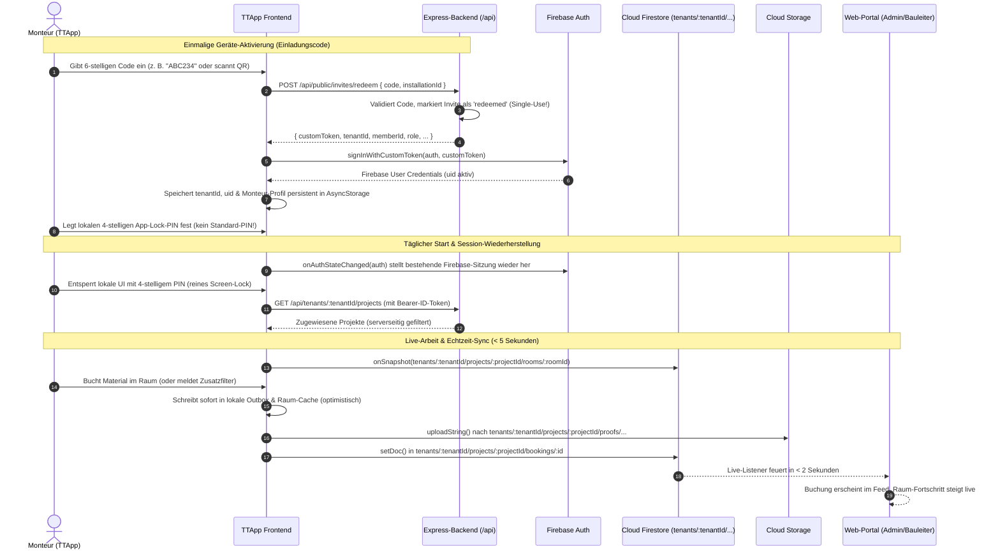

# Technische Spezifikation: TTApp Live-Sync, Auth & Mandanten-Migration (Final)

**Projekt:** TTApp (Monteur-App) / ToolTime (Burk Haustechnik / P12 Aufmaß)  
**Status:** Freigegebene Spezifikation (inkl. Sicherheits-, Storage- & Session-Hardening)  
**Datum:** 13. November 2026  
**Zielsystem:** Expo SDK 57 / React Native 0.86 / Firebase 12.19 / Express Backend  
**Verbindliche Handover-Regel:** Änderungen in der TTApp müssen zwingend in `TTApp/HANDOVER.md` gemäß den Vorgaben aus `AGENTS.md` (rollierendes 7-Tage-Fenster, stichpunktartig, exakte Testverifikation) dokumentiert werden.

---

## 1. Ausgangslage & Warum die App aktuell nicht synchronisiert

Im Zuge des Rollouts der Mandanten-Architektur im Web-Portal (`ToolTime/admin-web` und `ToolTime/backend`) wurden grundlegende Änderungen an Datenbankstruktur und Sicherheitsregeln vorgenommen:

1. **Mandanten-Isolation (`tenants/{tenantId}`):**  
   Alle Geschäftsdaten (Projekte, Räume, Positionen, Buchungen, Nachträge, Pläne) liegen nicht mehr auf Root-Ebene (`/projects/{projectId}/...`), sondern isoliert unter `tenants/{tenantId}/projects/{projectId}/...`. Die alten globalen Root-Sammlungen wurden geleert bzw. archiviert.
2. **Verschärfte Firestore- & Storage-Sicherheitsregeln:**  
   Unauthentifizierte Zugriffe auf Firestore und Storage sind serverseitig strikt gesperrt. Nur authentifizierte Nutzer (`request.auth.uid`) mit aktiver Mitgliedschaft und Zuweisung zum jeweiligen Projekt erhalten Lese- und Schreibrechte.
3. **Bestehende Blocker in der TTApp (`Branch: Monteur`):**  
   * **Veraltete Pfade & Root-Writes:** `syncService.js` greift auf `projects/{projectId}/...` zu und versucht globale Writes auf `/bookings` und `/addendums`, was von den Security Rules sofort mit `PERMISSION_DENIED` abgelehnt wird.
   * **Fehlendes Firebase Auth Token:** `authService.js` authentifiziert Monteure rein lokal über statische Seeds (`SEED_MONTEURS`) und einen lokalen 4-stelligen PIN – **ohne Firebase Auth Session**.
   * **Gefährlicher Datenverlust bei Fehlern:** In `syncService.js` (Zeilen 175–184) wird bei Nicht-Auffinden des Projekts unter Root `/projects` oder bei Permission-Denied fälschlicherweise `clearProjectCache(projectId)` aufgerufen, wodurch noch ungesyncte Offline-Buchungen unwiderruflich gelöscht werden!
   * **Fehlende Multi-Tenant Trennung im Offline-Speicher:** Caches und Outbox sind teils global oder nur nach `projectId` benannt und nutzen Initial-Dummy-Daten (`INITIAL_ROOMS`, `INITIAL_MATERIALS`).

---

## 2. Architektur-Zielbild: Authentifizierung, Session & Live-Sync



---

## 3. Präzisierte Anforderungen im Detail

### 3.1 Authentifizierung, Einladungscode & PIN-Sitzungsmanagement

1. **Einmaliger Einladungscode (Single-Use Token):**
   * Der Aktivierungscode (z. B. `ABC234` aus der Einladungs-PDF) ist ein **Einmalkennwort**.
   * Nach erfolgreicher Einlösung via `POST /api/public/invites/redeem` setzt das Backend den Status auf `redeemed`. Der Code kann nicht erneut eingelöst werden.
2. **Firebase Auth Session Persistence:**
   * Nach `signInWithCustomToken(auth, customToken)` speichert das Firebase JS SDK die Authentifizierung persistent (über den AsyncStorage-Auth-Persistence-Layer).
   * Bei jedem App-Neustart wird die Sitzung über `onAuthStateChanged(auth, user => ...)` automatisch wiederhergestellt – ein erneuter Aufruf von `redeem` ist **nicht** erforderlich und würde fehlschlagen.
3. **Lokaler 4-stelliger PIN als reine Bildschirmsperre (App-Lock):**
   * **Wichtig:** Es darf **kein Standard-PIN** (wie `1234`) fest im Code hinterlegt werden.
   * Der Monteur vergibt bei der Erstaktivierung seinen persönlichen 4-stelligen PIN (gespeichert als Hash oder Secure-Storage-Wert).
   * Der PIN dient **nur zur lokalen Bildschirmentsperrung** auf der Baustelle (Hosentaschenschutz), damit der Monteur nicht jedes Mal Anmeldedaten eingeben muss.
   * Der PIN loggt den Benutzer niemals bei Firebase aus.
4. **Re-Aktivierung & Geräteverlust:**
   * In den App-Einstellungen gibt es eine Option *„Gerät abmelden / Neues Gerät einrichten“*.
   * Vor dem Zurücksetzen erscheint ein deutlicher Dialog: *„Möchten Sie dieses Gerät wirklich trennen? Für eine erneute Aktivierung benötigen Sie einen neuen Einladungscode von Ihrem Bauleiter.“*
   * Bei Bestätigung werden Auth-Tokens und Caches gelöscht und der Einrichtungs-Screen angezeigt. Der Bauleiter kann im Web-Portal (`TenantMembersView.tsx`) per Klick einen frischen Einladungscode generieren.

---

### 3.2 Projektliste über die Backend-API laden (Kein unberechtigter Firestore-Scan)

* **Problemstellung:**  
  Die Firestore-Sicherheitsregeln erlauben das Lesen von Projekten nur, wenn der Monteur dem Projekt zugewiesen ist (`projectAssigned(tenantId, projectId)`). Ein unklausulierter Client-Query wie `getDocs(collection(db, 'tenants', tenantId, 'projects'))` schlägt fehl, da Firestore-Regeln Abfragen als Ganzes verifizieren.
* **Lösung:**  
  Die App ruft beim Start die Projektliste über den vorhandenen, abgesicherten Backend-Endpunkt ab:
  ```http
  GET /api/tenants/:tenantId/projects
  Authorization: Bearer <firebaseIdToken>
  ```
  Dieser Endpunkt nutzt das Firebase Admin SDK und liefert exakt die für den Monteur freigeschalteten Projekte (`assignedMonteurIds.includes(uid)` bzw. `assignedProjectIds`).
* **Fallback / Offline:**  
  Die geladenen Projekte werden im lokalen AsyncStorage unter `@ttapp:projects:${tenantId}:${userId}` zwischengespeichert. Ist das Smartphone offline, greift die App auf diesen Cache zu.

---

### 3.3 Fotouploads & Firebase Storage-Regeln

* **Backend-Status (bereits in `ToolTime/backend/storage.rules` implementiert):**  
  Die Storage-Regeln wurden angepasst, sodass zugewiesene Projektmitglieder (`projectAssigned`) Bilddateien bis zu 25 MB direkt unter dem Projektpfad erstellen dürfen:
  ```javascript
  match /tenants/{tenantId}/projects/{projectId}/{allPaths=**} {
    allow read: if isSuperadmin() || (activeMember(tenantId) && projectAssigned(tenantId, projectId));
    allow write: if tenantAdmin(tenantId) && request.resource.size < 100 * 1024 * 1024;
    allow create: if (isSuperadmin() || (activeMember(tenantId) && projectAssigned(tenantId, projectId)))
      && request.resource.size < 25 * 1024 * 1024
      && request.resource.contentType.matches('image/.*');
  }
  ```
* **Storage-Zielpfad in der TTApp (`syncService.js`):**
  ```javascript
  const storagePath = `tenants/${tenantId}/projects/${projectId}/proofs/${cleanId}_${photoIndex}_${timestamp}.jpg`;
  ```
  Der Upload erfolgt per `uploadString(ref(storage, storagePath), base64Data, 'base64', { contentType: 'image/jpeg' })`.

---

### 3.4 Offline-Daten, Caches & Schutz der Outbox

1. **Strikte Namespace-Trennung aller Speicher-Keys:**  
   In `src/services/storageService.js` müssen alle projektabhängigen Keys Mandant und Nutzer enthalten:
   * `@ttapp:rooms:${tenantId}:${userId}:${projectId}`
   * `@ttapp:materials:${tenantId}:${userId}:${projectId}`
   * `@ttapp:outbox_bookings:${tenantId}:${userId}:${projectId}`
   * `@ttapp:outbox_addendums:${tenantId}:${userId}:${projectId}`
   * `@ttapp:last_synced:${tenantId}:${userId}:${projectId}`
2. **Bereinigung von Dummy-Daten:**  
   Die statischen Beispieldaten (`INITIAL_ROOMS`, `INITIAL_MATERIALS`, `DEFAULT_PROJECT_ID`) dürfen keinesfalls in echte Mandanten-Projekte injiziert oder mit diesen gemischt werden. Sobald die App aktiviert ist, ist der Firestore-Server die alleinige Quelle der Wahrheit.
3. **Kritischer Schutz vor Datenverlust in `syncService.js`:**  
   * **Fehler-Ursache bisher:** Wenn Firestore beim Projekt-Check `exists == false` zurückgab (z. B. durch falsche Root-Pfade oder Berechtigungsfehler), rief `syncService.js` `clearProjectCache(projectId)` auf und löschte ungesyncte Buchungen!
   * **Neue Regel:**  
     `clearProjectCache()` darf **unter keinen Umständen** aufgerufen werden, solange sich in `outbox_bookings` oder `outbox_addendums` noch Einträge mit `status === 'pending'` befinden!
   * Tritt ein `permission-denied`- oder Netzwerkfehler auf, wird der Sync abgebrochen, der Fehler geloggt und die lokalen Buchungen bleiben mit Status `pending` unangetastet im Outbox-Speicher für den nächsten Retry.

---

### 3.5 Echtzeit-Synchronisation (< 5 Sekunden) & Live-Listener

1. **Push-Sync (App -> Web):**
   * Sobald der Monteur auf *„Buchung abschließen“* oder *„Raum abschließen“* klickt:
     * Die Buchung wird sofort lokal im Room-Cache und in der Outbox persistiert (UI reagiert verzögerungsfrei).
     * Im Hintergrund stößt die App sofort den Push-Sync an:
       ```javascript
       const bookingRef = doc(db, 'tenants', tenantId, 'projects', projectId, 'bookings', booking.id);
       await setDoc(bookingRef, {
         ...booking,
         createdByUid: auth.currentUser.uid, // Pflichtfeld für Security Rules!
         monteurUid: auth.currentUser.uid,
         monteurName: monteur.name,
         createdAt: booking.createdAt || new Date().toISOString(),
         syncedAt: new Date().toISOString(),
       }, { merge: true });
       ```
     * Da das Web-Portal (`admin-web`) einen Firestore Live-Listener auf die `bookings`-Subcollection hat, erscheint der Eintrag im Portal innerhalb von **unter 2 Sekunden** im Live-Feed.
2. **Pull-Sync via Firestore `onSnapshot` (Web -> App):**
   * Für den aktuell in der TTApp geöffneten Raum und die Projektansicht muss ein `onSnapshot`-Listener aktiv sein:
     * Listener auf `doc(db, 'tenants', tenantId, 'projects', projectId, 'rooms', roomId)`
     * Ändert der Bauleiter im Web z. B. Vorgaben oder entsperrt einen Raum, sieht der Monteur die Änderung sofort (< 5s), ohne die App neu starten zu müssen.
3. **Konfliktbehandlung bei gleichzeitigen Änderungen:**
   * **Buchungen & Nachträge:** Sind vollständig **append-only** mit eindeutigen UUIDs (`id: uuidv4()`). Es können niemals Überschreib-Konflikte auftreten.
   * **Raum-Status:** Bei Statusänderungen (`pct`, `isCompleted`) gilt: Der letzte Schreibvorgang mit `updatedAt: serverTimestamp()` gewinnt (Last-Write-Wins).

---

### 3.6 Nachträge & Zusatzmaterial (`addendums`)

* **Außerplanmäßiges Material durch Monteur:**
  * Wenn der Monteur vor Ort ein Bauteil montiert, das nicht im Leistungsverzeichnis stand (z. B. zusätzlicher Filter):
    * Erfassung über das Modal *„Außerplanmäßig“*.
    * Speicherung in `tenants/${tenantId}/projects/${projectId}/addendums/${addendumId}` mit:
      ```javascript
      {
        id: addendumId,
        projectId,
        roomId,
        roomName,
        deviationType: 'new_item',
        deviationSource: 'monteur',
        status: 'pending',
        shortText: materialName,
        quantity: Number(qty),
        qu: unit || 'Stk',
        reason: reason || 'Vor Ort zusätzlich benötigt',
        createdByUid: auth.currentUser.uid,
        requestedBy: monteur.name,
        createdAt: new Date().toISOString(),
      }
      ```
    * **Im Web-Portal:** Erscheint unter *„Nachträge“* sofort als neue Kachel mit dem Monteurnamen und den Aktions-Buttons (`verfügbar - freigeben`, `nicht verfügbar - anfragen`, `Als neue LV-Position anlegen`).

---

## 4. Übersicht der Firestore-Pfade (Multi-Tenant Matrix)

| Datentyp | Bisheriger Pfad in TTApp (Veraltet) | Neuer korrekter Mandanten-Pfad |
| :--- | :--- | :--- |
| **Projekt** | `projects/${projectId}` | `tenants/${tenantId}/projects/${projectId}` |
| **Räume** | `projects/${projectId}/rooms` | `tenants/${tenantId}/projects/${projectId}/rooms` |
| **Positionen / LV** | `projects/${projectId}/positions` | `tenants/${tenantId}/projects/${projectId}/positions` |
| **Buchungen** | `projects/${projectId}/bookings` & `/bookings` | `tenants/${tenantId}/projects/${projectId}/bookings` *(Root-Writes entfernt!)* |
| **Nachträge** | `projects/${projectId}/addendums` & `/addendums` | `tenants/${tenantId}/projects/${projectId}/addendums` *(Root-Writes entfernt!)* |
| **Montagepläne** | `projects/${projectId}/plans` | `tenants/${tenantId}/projects/${projectId}/plans` |
| **Beweisfotos** | `projects/${projectId}/proofs/...` | `tenants/${tenantId}/projects/${projectId}/proofs/...` *(Storage)* |

---

## 5. Abnahmekriterien für die Implementierung

1. **Aktivierung:** Eingabe eines gültigen Einladungscodes führt zu erfolgreichem `signInWithCustomToken` und Festlegung eines individuellen 4-stelligen App-Lock-PINs.
2. **Sitzungsfortführung:** Nach Beenden und erneutem Starten der App reicht die PIN-Eingabe aus; die Firebase-Session ist ohne Neuaktivierung aktiv.
3. **Projekt-Laden:** Die Projektliste wird fehlerfrei via `GET /api/tenants/:tenantId/projects` bezogen und offline gecacht.
4. **Live-Buchung (< 5s):** Eine Materialbuchung im Raum erscheint innerhalb von 2–5 Sekunden im Web-Portal im Live-Feed und aktualisiert die Prozentanzeige.
5. **Nachtragsmeldung:** Vor Ort erfasstes Zusatzmaterial erscheint im Web-Portal unter Nachträge.
6. **Fotoupload:** Beweisfotos werden ohne `permission-denied` in den Mandanten-Storage hochgeladen.
7. **Offline-Resilienz:** Bei simuliertem Flugmodus werden Buchungen in der Outbox gehalten und bei Wiederverbindung synchronisiert, ohne dass Caches gelöscht werden.
8. **Dokumentation:** Vollständige, stichpunktartige Dokumentation in `TTApp/HANDOVER.md` gemäß `AGENTS.md`.
