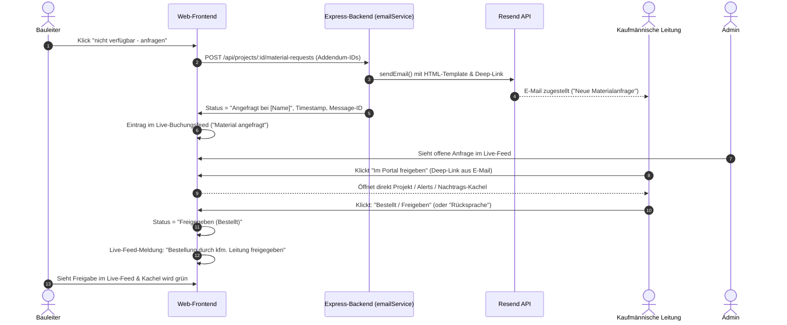
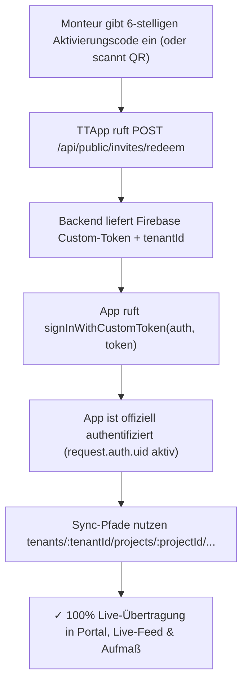

# Konzept: Optimierung Nachtrags-Management, Materialanfragen & Kaufmännischer Workflow

**Projekt:** ToolTime / Burk Haustechnik (P12 Aufmaß)  
**Status:** Konzept / Änderungswünsche  
**Datum:** 13. November 2026  
**Autor:** Antigravity / Entwicklungsteam  

---

## 1. Ausgangslage & Zielsetzung

Aus dem Abgleich von Ausschreibung (GAEB) und Ausführungsplanung (DWG/CAD) entstehen auf Baustellen Mengenmehrungen oder Bedarfe an neuem/zusätzlichem Material.

Die aktuelle Ansicht im Nachtrags-Dashboard (`AddendumsView`) weist funktionale Unschärfen und Redundanzen auf:
1. **Redundante Texte:** Identische Beschreibungen erscheinen doppelt auf einer Kachel.
2. **Überflüssige Badges:** Bei projektweiten Abweichungen (GAEB vs. DWG) sind Tags wie *„Baustelle“* oder *„Abweichung GAEB vs. DWG“* ohne Mehrwert, da die Begründung diesen Sachverhalt bereits vollständig erklärt.
3. **Irreführende Aktionen:** Der gelbe Button *„Als LV-Position ins Aufmaß übernehmen“* wird aktuell auch bei reinen Mengenmehrungen angezeigt, obwohl das Material bereits als LV-Position existiert und das Leistungsverzeichnis nicht dupliziert werden soll.
4. **Fehlender Autosuggestor & zu enges Modal:** Das Modal *„Mehrbedarf erfassen“* ist visuell zu klein, enthält nicht benötigte Optionen (Regiestunden/Zeit) und bietet keine Such- bzw. Autovervollständigung für bestehende LV-Positionen.
5. **Unterbrochene Kommunikationskette:** Kaufmännische Anfragen erfolgen per E-Mail, ohne dass ein direkter Rückkanal oder Deep-Link in die Web-App führt, über den die kaufmännische Leitung den Vorgang mit einem Klick bestätigen kann.

Dieses Konzept bündelt die definierten Änderungswünsche in ein praxistaugliches, sauberes Gesamtsystem.

---

## 2. Kachel-Optimierung & Visuelle Bereinigung (`AddendumsView`)

### 2.1 Beseitigung der doppelten Beschreibung (Bugfix)
* **Problem:** `item.description` wird aktuell sowohl als Untertitel unter der Überschrift (Zeile 879) als auch nochmals in der grauen Begründungsbox (Zeile 951) gerendert.
* **Lösung:** 
  * Der Untertitel direkt unter `item.title` entfällt.
  * Die Beschreibung wird **ausschließlich 1×** in der dafür vorgesehenen Begründungsbox gerendert.

### 2.2 Bereinigung der Badges
* **Entfall von „Baustelle“ (mit Pin):** Bei projektweiten Nachträgen (ohne Zuordnung zu einem einzelnen spezifischen Raum) wird das neutrale Tag *„Baustelle“* ersatzlos ausgeblendet. Ein Raum-Tag erscheint nur dann, wenn ein Monteur konkret in einem spezifischen Raum (z. B. *„Bad EG“*) gebucht hat.
* **Entfall von „Abweichung GAEB vs. DWG“:** Da die Langbeschreibung die Diskrepanz bereits ausführlich herleitet, entfällt dieses zusätzliche Tag.

### 2.3 Schlanke Kachel-Struktur (Ziel-Layout)
Jede Nachtragskachel folgt von oben nach unten einer klaren Hierarchie:
1. **Kategorie-Badge:** `📦 Mehr Material benötigt` (oder `❓ Anderes Material`) + Status-Pill (`Ausstehend` / `Angefragt` / `Freigegeben`)
2. **Titel & Menge:** z. B. `Mengenmehrung: Kunststoffrohr DN 100` mit Mengen-Pill `+64 m`
3. **Begründungsbox:** Prägnant gerahmter Block mit der Begründung und Raumaufteilung
4. **Erfasser & Datum:** z. B. `Eingestellt von: Bauleiter (Peter Suhayda) am 13.11.2026`
5. **Ampel & Materialbestand:**
   * Noch verfügbar (Lager / Baustelle)
   * Laut Planung benötigt (Restprojekt)
   * Fehlmenge / Überschuss
6. **Aktionsleiste (alle Buttons in einer horizontalen Zeile)**

---

## 3. Button-Logik, Namensgebung & Layout

### 3.1 Bedingte Sichtbarkeit des gelben Buttons
* **Regel:** Handelt es sich um eine **reine Mengenmehrung** einer bereits im LV vorhandenen Position (z. B. `item.deviationSource === 'gaeb_vs_dwg'` oder `item.materialId` / `item.itemOz` existiert im Projektstamm), wird der gelbe Button **vollständig ausgeblendet**.
* **Sichtbarkeit nur bei:**
  * Neuem Material, das bisher **nicht** im LV enthalten ist.
  * Außerplanmäßig vom Monteur verbautem Material ohne LV-Match.

### 3.2 Neue einheitliche Button-Namen & Farbcodierung
Alle Buttons werden einheitlich benannt und in **einer einzigen Zeile** am Kachelende ausgerichtet:

| Bisheriger Text | Neuer Text | Farbe / Stil | Wann sichtbar? |
| :--- | :--- | :--- | :--- |
| *Material verfügbar – Freigeben* | **verfügbar - freigeben** | Grün (`#2FA36B`) | Immer bei ausstehenden Materialnachträgen |
| *Material anfragen* | **nicht verfügbar - anfragen** | Blau (`#3B82C4`) | Immer bei ausstehenden Materialnachträgen |
| *Als LV-Position ins Aufmaß übernehmen* | **Als neue LV-Position anlegen** *(Empfehlung)* | Gelb/Amber (`amber-100` / `border-amber-300`) | **Nur** bei neuem, bisher nicht im LV existierendem Material |
| *Ablehnen* | **Ablehnen** | Rot-Outline | Immer bei Status *Ausstehend* |

> [!TIP]
> **Namensempfehlung für den gelben Button:**  
> **„Als neue LV-Position anlegen“** (oder kurz: **„In LV aufnehmen“**).  
> Da der Button nur noch bei tatsächlich *neuen* Positionen eingeblendet wird, drückt dieser Name präzise aus, dass hieraus eine offizielle vertragliche Nachtragsposition (z. B. `N-01`) im Leistungsverzeichnis entsteht.

### 3.3 Bugfix: Doppeltes Pluszeichen im Header-Button
* Im Header von `AddendumsView` befindet sich aktuell das Icon `<Plus />` gefolgt von `<span>+ Mehrbedarf erfassen</span>`, was visuell zu `+ + Mehrbedarf erfassen` führt.
* **Korrektur:** Text auf `<span>Mehrbedarf erfassen</span>` bereinigen (nur noch ein Plus über das Icon).

---

## 4. Erfassung von Mehrbedarf: Monteur vs. Bauleiter & Modal-Redesign

### 4.1 Erfassung durch den Monteur (App)
* Der Monteur kann direkt vor Ort in seinem Raum erfassen, wenn er ein Bauteil verbaut hat, das nicht im Plan stand (z. B. *„Filter DN 25 zusätzlich eingebaut“*).
* Dies landet im Portal automatisch als Nachtrag vom Typ `Anderes Material verbaut` mit Herkunft `Monteur ([Name])`.
* Für diesen Fall steht der Bauleitung der gelbe Button **„Als neue LV-Position anlegen“** zur Verfügung, um das Bauteil offiziell zu bemustern, zu bepreisen und ins Projekt-LV aufzunehmen.

### 4.2 Modal-Redesign für den Bauleiter („Mehrbedarf erfassen“)
Aktuell ist das Dialogfenster (`isCreateModalOpen`) zu klein (`max-w-lg`) und unpassend aufgebaut.

#### Vorgesehene Änderungen:
1. **Großzügiges Layout:**
   * Verbreiterung auf `max-w-2xl` oder `max-w-3xl` mit luftigen Abständen, großzügigen Eingabefeldern und klarer Schriftgröße.
2. **Entfall der Zeit-/Stunden-Option:**
   * Der Reiter *„⏱ Stunden / Mehr Zeit, Regie“* wird komplett entfernt.
   * Es stehen nur noch zwei klare Modi zur Auswahl:
     * **A. Mengenmehrung** (Bedarf an vorhandenem Material steigt)
     * **B. Neues Material** (Bisher nicht im Leistungsverzeichnis enthalten)
3. **Autosuggestor / Autocomplete bei Mengenmehrung:**
   * Wird *„Mengenmehrung“* gewählt, darf der Artikelname **kein freies Textfeld** sein.
   * Ein **Such-Dropdown mit Autosuggestion** durchsucht alle im Projekt vorhandenen LV-Positionen nach:
     * Positionsnummer (z. B. `01.02.0040`)
     * Kurztext / Materialbezeichnung (z. B. `Kunststoffrohr DN 100`)
     * Gewerk / Gruppe
   * Bei Auswahl der Position werden Einheit (`m`, `Stk`), Einzelpreis und GAEB-Sollmenge automatisch übernommen.
4. **Freitext nur bei „Neues Material“:**
   * Nur im Modus *„Neues Material“* kann der Bauleiter Artikelbezeichnung, Hersteller und Einheit frei eintippen.

---

## 5. Kaufmännischer Freigabe- & Kommunikations-Workflow (Closed-Loop)

Bislang erzeugt die Web-App lediglich einen lokalen `mailto:`-Link (der auf dem Bauleiter-Gerät ein Mailprogramm wie Outlook/Thunderbird öffnen muss). 

**Neu mit Resend:**  
Das Projekt verfügt im Express-Backend (`backend/services/emailService.js`) bereits über den zentralen Transaktionsdienst **Resend** (`https://api.resend.com/emails`, Absender standardmäßig `P12 Aufmaß <info@p12-aufmass.de>`). Materialanfragen werden künftig **direkt serverseitig über Resend** versendet. Kein lokaler Mailclient mehr nötig, 100% verlässlich und nachvollziehbar!



### 5.1 Serverseitiger Resend-Versand (`emailService.js`)
* Beim Absenden der Anfrage (einzeln oder als Sammelanfrage) ruft das Frontend die bestehende Backend-Route `POST /api/tenants/:tenantId/projects/:projectId/material-orders` auf.
* Das Backend nutzt `sendEmail(...)` via Resend (`backend/services/emailService.js`):
  * **Empfänger:** Kaufmännische Leitung des Projekts (z. B. `andreas@burk-haustechnik.de`).
  * **Absender:** `P12 Aufmaß <info@p12-aufmass.de>`.
  * **HTML-Template:** Formatiertes Template im Firmen-Branding mit Übersichtstabelle (Projekt, PosNr, Material, Menge, Begründung, Bauleiter).
  * **Direkter Call-to-Action:** Großer Button *„Jetzt im Portal prüfen & freigeben“*.
  * **Idempotency-Key:** Verhindert Doppelsendungen bei mehrfachem Klick.

### 5.2 Portal-Deep-Link in der E-Mail
Die generierte E-Mail erhält den klickbaren Direktlink:
```text
https://[Portal-Domain]/t/[Tenant-Slug]?project=[ProjectId]&tab=addendums&item=[AddendumId]
```
Klickt der kaufmännische Leiter auf den Link, landet er nach dem Login direkt im betreffenden Projekt bei der konkreten Anfrage.

### 5.3 Ansicht der Kaufmännischen Leitung
* **Kachel in Alerts / Nachträge:**
  * Der kaufmännische Leiter sieht eine speziell hervorgehobene Karte mit den Bestelldetails (Menge, Grund, Baustelle, Bauleiter).
  * Er verfügt über zwei Hauptaktionen:
    1. **✓ Bestellt / Freigeben:** Bestätigt, dass die Bestellung beim Großhändler platziert wurde.
    2. **💬 Rücksprache erforderlich:** Hinterlegt eine kurze Notiz für den Bauleiter (z. B. *„Lieferzeit 3 Wochen, Alternative prüfen?“*).

### 5.4 Live-Buchungsfeed & Audit-Trail
Jede Interaktion erzeugt einen transparenten Eintrag im Live-Feed:
* **Bei Anfrage:**  
  *„Bauleiter Peter Suhayda hat 64 m Kunststoffrohr DN 100 angefragt (kfm. Prüfung bei Andreas).“*
* **Bei kaufmännischer Freigabe:**  
  *„Kaufmännische Leitung (Andreas) hat Nachbestellung für Kunststoffrohr DN 100 bestätigt.“*
* **Sichtbarkeit:**
  * Der Bauleiter sieht sofort, dass sein Material unterwegs ist.
  * Der Administrator sieht im globalen Feed alle offenen vs. bestätigten Beschaffungsvorgänge.

---

## 6. Layout-Kompaktierung: „Räume & Etagen“ (Einheitlicher Kasten mit Pläne-Dropdown)

### 6.1 Bisheriger Zustand (Problem)
In der Ansicht *„Räume & Etagen“* (`RoomManager.tsx`) werden aktuell **zwei separate, riesige Kästen** über den eigentlichen Räumen gerendert:
1. Der Header-Kasten (*„Raum- & Baustellen-Konfigurator“*) mit den Buttons zum Hochladen und Anlegen.
2. Ein zweiter, massiver Kasten (*„Hinterlegte Ausführungs- & Montagepläne (6)“*), der ein 2×3-Kachelraster aller hochgeladenen CAD/PDF-Pläne dauerhaft anzeigt.

Dieser zweite Kasten verdrängt die eigentliche Arbeitsfläche (die Räume, Etagen und den Fertigstellungsfortschritt) weit nach unten, obwohl die Pläne nur selten eingesehen oder gewechselt werden müssen.

### 6.2 Ziel-Zustand (Ein einziger schlanker Kasten)
Der gesamte obere Bereich wird in **einen einzigen, aufgeräumten Kasten** zusammengefasst:

1. **Kompakter Titel:**
   * Titel: **„Räume & Etagen“**
   * Dezente Subzeile: *„Örtlichkeiten der Verbauung: Räume aus Montageplänen oder manuell angelegt“*

2. **Drei Aktionen in einer Zeile:**
   * Button: **„Plan hochladen“** (oder `Plan hochladen (.dwg / .dxf / .pdf)`)
   * Button: **„+ Raum manuell anlegen“**
   * Dropdown-Trigger: **„Angelegte Ausführungs- & Montagepläne (6) ▼“** (mit Pfeil/Chevron)

3. **Interaktives Dropdown / Einklapp-Funktion:**
   * **Standard:** Die Pläne sind **eingeklappt / unsichtbar**. Der Header-Kasten ist nur ca. 80 Pixel hoch. Die Räume und Etagen sind sofort im Fokus.
   * **Bei Klick auf „Angelegte Ausführungs- & Montagepläne“:**
     * Es klappt direkt im selben Kasten nach unten ein kompaktes Menü/Raster der hinterlegten Pläne auf (inkl. Download, Ebenen-Zuweisung und Viewer-Aufruf).
     * Alternativ kann es als elegantes Popover/Dropdown-Menü geöffnet werden.
     * Ein erneuter Klick oder Klick außerhalb klappt die Pläne wieder ein.

---

## 7. Modernisierung „Benutzer & Rollen“ (`TenantMembersView`)

### 7.1 Bisheriger Zustand (Problem)
In der aktuellen Mitglieder-Verwaltung (`TenantMembersView.tsx`) erfolgt die Projektzuweisung über eine einfache Zeile kleiner Standard-Checkboxen.
* Es ist unübersichtlich, welche Mitarbeiter aktuell auf welchen Baustellen eingesetzt sind.
* Das Entfernen oder Hinzufügen von Projekten ist nicht intuitiv.
* Es fehlt die direkte Anzeige von Kontaktdaten wie der **Telefonnummer** für schnelle Rückfragen von der Baustelle.
* Beim Monteur ist die eingestellte Sprache nicht auf den ersten Blick erkennbar.

### 7.2 Neuer visueller Aufbau der Mitglieder-Karten
Jedes Mitglied (egal ob Bauleiter, Monteur oder kaufmännische Leitung) erhält eine klare, strukturierte Karte:

1. **Kopfzeile & Kontaktdaten:**
   * **Name & Status:** z. B. `Peter Suhayda · Aktiv` (mit Rollen-Badge).
   * **Kontaktdaten:**
     * E-Mail-Adresse (z. B. `suhayda@gmail.com`)
     * **Telefonnummer:** Direkt sichtbar mit Anruf-Icon (z. B. `📞 +49 171 2345678` oder klickbar als `+ Telefonnummer hinterlegen`).
   * **Beim Monteur zusätzlich:**
     * **Sprach-Badge:** z. B. 🇩🇪 Deutsch, 🇷🇴 Rumänisch, 🇵🇱 Polnisch, 🇭🇷 Kroatisch (schnell per Dropdown umschaltbar).
     * **PIN / Aktivierungscode:** Für die Monteur-App.
   * **Aktionen rechts:** Rollen-Dropdown (`Bauleiter`, `Kaufmännisch`, `Monteur`, `Administrator`) + Button `Deaktivieren` / `Aktivieren`.

2. **Zugeordnete Projekte als Kacheln (Badges mit „✕“):**
   * Unterhalb der Kontaktdaten erscheint der Bereich: *„Zugeordnete Projekte:“*
   * Jedes zugewiesene Projekt wird als markante Kachel dargestellt:
     ```text
     [ 🏢 Hallenbad Weingarten  ✕ ]   [ 🏢 EFH Demo Projekt  ✕ ]
     ```
   * **Sofortiges Entfernen:** Klickt der Administrator auf das **`✕`** an der Kachel, wird die Person sofort und unkompliziert aus diesem Projekt entfernt.

3. **Button „+ Projekt zuordnen“ mit Zuordnungs-Modal:**
   * Direkt neben den Projekt-Kacheln befindet sich der Button: **`+ Projekt zuordnen`**.
   * **Modal „Projekt zuordnen für [Mitarbeitername]“:**
     * Klick auf den Button öffnet ein übersichtliches Dialogfenster.
     * Das Modal zeigt **nur diejenigen Projekte**, denen der Mitarbeiter aktuell noch **nicht** zugeordnet ist.
     * Jedes Projekt wird mit Projektname, Adresse und aktuellem Status zur einfachen Auswahl gelistet.
     * Ein Klick auf ein Projekt weist es dem Mitarbeiter zu und schließt das Modal.
   * Sind einer Person bereits alle verfügbaren Projekte zugewiesen, wird der Button deaktiviert bzw. ausgeblendet (*„Allen Projekten zugeordnet“*).

4. **Rollenumfassende Gültigkeit:**
   * Diese Projektzuordnung gilt für **alle operativen Rollen**:
     * **Monteur:** Bestimmt, welche Baustellen der Monteur in der mobilen App sieht.
     * **Bauleiter:** Bestimmt, für welche Projekte der Bauleiter zuständig ist und Berechtigungen besitzt.
     * **Kaufmännische Leitung:** Bestimmt, für welche Projekte Materialanfragen und Bestellfreigaben empfangen werden.

---

## 8. App-Parität & Live-Synchronisation (`TTApp` Monteur-App)

### 8.1 Dringender Prüfbefund: Das Mandanten-Gap
Die technische Analyse der Monteur-App (`/home/oem/Programming/TTApp` auf Branch `Monteur`) offenbart eine **kritische Diskrepanz** zum aktuellen Web- und Backend-Stand:

1. **Veraltete Firestore-Pfade in `syncService.js`:**
   * Die Monteur-App liest und schreibt aktuell noch auf die **alten globalen Root-Pfade**:
     * `doc(db, 'projects', projectId, 'rooms', room.id)`
     * `doc(db, 'projects', projectId, 'bookings', booking.id)`
     * `doc(db, 'projects', projectId, 'addendums', addendum.id)`
     * `doc(db, 'projects', projectId, 'positions', ...)`
   * **Problem:** Im Web-Portal (`admin-web`) und Backend wurden diese globalen Pfade im Zuge der Mandantenfähigkeit vollständig abgelöst. Alle Live-Daten liegen nun strikt unter:
     `tenants/{tenantId}/projects/{projectId}/...`
   * Die globalen Root-Pfade wurden bereinigt und sind in den neuen Firestore-Sicherheitsregeln gesperrt (`match /{document=**} { allow read, write: if false; }`).

2. **Fehlende Firebase-Authentication in der App:**
   * Die App authentifiziert Monteure aktuell rein offline über lokale Seeds (`SEED_MONTEURS`) und PIN-Code (`authService.js`), **ohne ein Firebase Auth Token** (`request.auth == null`).
   * Die produktiven Firestore-Regeln (`backend/firestore.rules`) blockieren jedoch jeden unauthentifizierten Schreib- und Lesezugriff strikt:
     ```javascript
     allow create: if projectAssigned(tenantId, projectId) && request.resource.data.createdByUid == request.auth.uid;
     ```
   * **Konsequenz:** Synchronisiert die App heute, schlägt der Sync still fehl (`PERMISSION_DENIED`) oder arbeitet auf veralteten/leeren Root-Mock-Daten. Änderungen der Monteure kommen **nicht im Web-Portal** an, und neue LV-Positionen des Bauleiters erreichen die App nicht!

---

### 8.2 Erforderliche Anpassungen für den Live-Sync

Damit die Monteur-App nahtlos mit der neuen Website und dem Live-Backend synchronisiert, müssen folgende Punkte umgesetzt werden:



1. **Aktivierungs- & Token-Flow (`authService.js`):**
   * Die App nutzt die bereits im Backend vorhandene Route `POST /api/public/invites/redeem` mit dem 6-stelligen Aktivierungscode (z. B. `AB-C234` aus der Einladungs-PDF).
   * Bei erfolgreicher Einlösung erhält die App ein `customToken` und die `tenantId` (z. B. `burk`).
   * Die App loggt sich via `signInWithCustomToken(auth, customToken)` ein. Das Auth-Token wird persistent gespeichert.

2. **Dynamische Mandanten-Pfade in `syncService.js`:**
   * Alle Firestore-Operationen in `syncService.js` erhalten das Präfix `tenants/${tenantId}/`:
     * `tenants/${tenantId}/projects/${projectId}/positions`
     * `tenants/${tenantId}/projects/${projectId}/rooms`
     * `tenants/${tenantId}/projects/${projectId}/bookings`
     * `tenants/${tenantId}/projects/${projectId}/addendums`
     * `tenants/${tenantId}/projects/${projectId}/plans`
   * In `bookingPayload` und `addendumPayload` wird `createdByUid: auth.currentUser.uid` mitgeschickt, um den `firestore.rules` exakt zu entsprechen.

3. **Sofortige Daten-Parität:**
   * **Buchungen:** Jede Fertigmeldung und jeder Schieberegler-Fortschritt im Raum erzeugt sofort den Eintrag im Live-Buchungsfeed des Bauleiters.
   * **Zusatzmaterial (Filter etc.):** Vom Monteur gemeldeter Mehrbedarf landet sofort als Kachel in `AddendumsView` der Web-App.
   * **Neue LV-Positionen:** Wenn der Bauleiter einen Nachtrag als neue LV-Position anlegt, zieht die App beim nächsten automatischen Delta-Sync die neue Position in den Raum.

---

## 9. Datenmodell-Anpassungen (Firestore & Backend)

1. **Subcollection `tenants/{tenantId}/members/{uid}`:**
   ```typescript
   interface Member {
     id: string;
     displayName?: string;
     email?: string;
     phone?: string;                     // Neu: Telefonnummer für direkte Erreichbarkeit
     role: 'admin' | 'bauleiter' | 'kaufmaennisch' | 'monteur';
     status: 'active' | 'inactive';
     assignedProjectIds: string[];       // Liste der Projekt-IDs
     defaultLanguage?: 'de' | 'ro' | 'pl' | 'hr'; // Spracheinstellung (primär Monteur)
     pin?: string;                       // 4-stelliger App-PIN
     updatedAt?: string;
   }
   ```
2. **Backend-Patch:**  
   Die Route `PATCH /api/tenants/:tenantId/members/:uid` wird erweitert, sodass neben `assignedProjectIds` auch `phone` und `defaultLanguage` validiert und gespeichert werden.

3. **Subcollection `addendums` (Kaufmännischer Workflow):**
   ```typescript
   interface Addendum {
     id: string;
     projectId: string;
     title: string;
     quantity: number | string;
     qu: string;
     status: 'pending' | 'requested' | 'approved' | 'rejected' | 'needs_discussion';
     requestedTo?: string;            // Name kfm. Leitung
     requestedToEmail?: string;       // E-Mail-Adresse
     requestedAt?: string;            // ISO Timestamp
     commercialApprovedBy?: string;   // Freigegeben durch
     commercialApprovedAt?: string;
     commercialNote?: string;
     materialId?: string;             // Bestehende LV-Position
     itemOz?: string;
     isNewMaterial?: boolean;
   }
   ```

---

## 10. Umsetzungsschritte (Roadmap)

### Phase 1: Sofortmaßnahmen (Frontend-Bereinigung & Layout-Kompaktierung)
1. **Nachtrags-Kacheln (`AddendumsView`):**
   * Doppelte Beschreibung entfernen.
   * Badges *„Baustelle“* und *„Abweichung GAEB vs. DWG“* bei projektweiten Mehrungen ausblenden.
   * Doppeltes Pluszeichen im Header-Button entfernen.
   * Gelben Button bei reinen Mengenmehrungen ausblenden.
   * Buttons umbenennen (`verfügbar - freigeben`, `nicht verfügbar - anfragen`, `Als neue LV-Position anlegen`) und in einer Zeile anordnen.
2. **Kompakter Header „Räume & Etagen“ (`RoomManager`):**
   * Zusammenführung zu einem einzigen Header-Kasten mit Titel *„Räume & Etagen“*.
   * Integration des Dropdown-Buttons *„Angelegte Ausführungs- & Montagepläne (X) ▼“*.
   * Standardmäßiges Ausblenden des riesigen Pläne-Rasters zur Schonung des vertikalen Platzes.

### Phase 2: Benutzer & Rollen Modernisierung (`TenantMembersView`)
1. Umbau der Projektzuweisung: Kacheln mit `✕`-Button zum Entfernen.
2. Neues Modal *„Projekt zuordnen“* mit Liste der noch nicht zugewiesenen Projekte.
3. Telefonnummer-Feld und -Anzeige in der Mitgliedskarte integrieren.
4. Sprach-Auswahl und PIN-Anzeige beim Monteur direkt in der Karte verankern.
5. Backend `PATCH /api/tenants/:tenantId/members/:uid` um `phone` und `defaultLanguage` ergänzen.

### Phase 3: Monteur-App Live-Sync & Mandanten-Anbindung (`TTApp`)
1. `syncService.js` der App auf mandantenfähige Pfade (`tenants/${tenantId}/projects/${projectId}/...`) umstellen.
2. Firebase Authentication Token-Login (`signInWithCustomToken`) via Aktivierungscode anbinden.
3. `createdByUid` in Buchungen und Addendums setzen, um den `firestore.rules` zu entsprechen.
4. End-to-End-Test: Monteur bucht im Raum -> erscheint live im LiveFeed und Aufmaß der Web-App.

### Phase 4: Großzügiges Nachtrags-Modal & Autosuggestor
1. Modal *„Mehrbedarf erfassen“* vergrößern (`max-w-2xl` / `max-w-3xl`).
2. Stunden/Regie-Auswahl ausblenden.
3. Autosuggestor-Komponente auf Basis der Projekt-Positionen für den Modus *„Mengenmehrung“* integrieren.

### Phase 5: E-Mail-Versand via Resend & Kaufmännischer Bestätigungs-Workflow
1. Backend-Route `POST /api/tenants/:tenantId/projects/:projectId/material-orders` anbinden.
2. Formatiertes HTML-E-Mail-Template mit Deep-Link (*„Jetzt im Portal prüfen & freigeben“*) und Idempotency-Key hinterlegen.
3. Bestätigungs-Aktion für die Rolle `kaufmaennisch` in `AddendumsView` bzw. `AlertsBanner` aktivieren.
4. Live-Feed-Events bei Anfrage und kaufmännischer Freigabe in Firestore schreiben.


